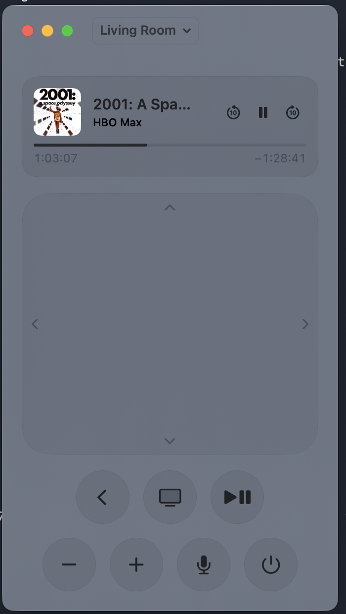

# Apple TV Remote for Mac

A native macOS remote for any Apple TV on your network. The app is Swift and SwiftUI. It
speaks the same protocol as the Siri Remote and the iPhone Remote.



## Install

### Option 1: the DMG

1. Download `AppleTVRemote.dmg` from the Releases page.
2. Open the DMG. Drag **Apple TV Remote** to Applications.
3. Right-click the app in Applications and choose **Open**. Click **Open** in the dialog.
   macOS shows this dialog one time, because the app is not notarized.
4. Click **Allow** when macOS asks for local network access. The app needs it to find your
   Apple TV.

### Option 2: build from source

You do not need Xcode. The Command Line Tools are enough.

```sh
xcode-select --install
git clone https://github.com/areddy1000/apple-tv-remote-mac.git
cd apple-tv-remote-mac
scripts/run.sh
```

The script builds the app, makes the bundle, and opens it. `scripts/make-dmg.sh` makes a
release DMG. `scripts/test.sh` runs the unit tests.

## Pair with your Apple TV

1. Open the app. The toolbar shows the first Apple TV it finds. Click the name to pick
   another one.
2. The TV shows a four-digit code. Type the code into the sheet. Click **Pair**.

That is the only code. The app keeps the pairing. Later launches connect in less than one
second with no code.

To pair again, choose **Forget This Apple TV** from the device menu. Then click the device
name to connect.

## The remote

| Control | Action |
| --- | --- |
| Scroll on the clickpad | Swipe |
| Click the centre of the clickpad | Select |
| Click near an edge of the clickpad | Up, Down, Left or Right |
| Back | Go up one level |
| TV | Go to the Home screen |
| Play/Pause | Play or pause |
| Minus, Plus | Volume down, volume up |
| Microphone | Siri. Hold the button while you speak |
| Power | Sleep an awake TV. Wake a sleeping TV |

The now-playing card appears at the top while media plays. It shows the artwork, the title,
the app and a progress bar. The card has pause, play, skip back and skip forward buttons.
Each skip moves ten seconds. Drag anywhere on the progress bar to seek. The time labels follow
the pointer while you drag, and playback moves when you let go.

A volume slider appears below the buttons when the TV reports a volume level. A television
on HDMI-CEC reports no level, so the slider stays hidden. AirPlay speakers and HomePods
report a level.

## Keys

| Key | Action |
| --- | --- |
| Arrow keys | Move |
| Return | Select |
| Escape or Delete | Back |
| Space | Play/Pause |
| Command-Up, Command-Down | Volume up, volume down |
| Command-K | Open an app. Type to filter. Press Return to launch |
| Command-T | Show the text bar |
| Command-Shift-H | TV (Home screen) |
| Command-1 to Command-9 | Switch to another Apple TV |
| Control-Option-R | Bring the remote window to the front from any app |

Hold an arrow key to repeat the move. Hold Return for a long press of Select.

## Type on the Apple TV

1. Open a text field on the TV. For example, open Search.
2. The text bar appears in the app. Press Command-T if it does not.
3. Type on the Mac keyboard. Paste works.
4. Press Return to run the search.
5. Press Escape to close the bar and go back one level.

## Menu bar

Click the menu bar item to show a compact remote. While media plays, the item shows the
artwork and the title. Click the window button in the panel to open the full window.

## Command line tool

The build also makes `atvctl`. It shares the pairing with the app. Quit the app before you
use it, because the Apple TV allows one session for each paired client.

```sh
.build/debug/atvctl discover
.build/debug/atvctl press select
.build/debug/atvctl press menu
.build/debug/atvctl press play-pause --hold 300
.build/debug/atvctl swipe down
.build/debug/atvctl type "hello"
.build/debug/atvctl apps
.build/debug/atvctl launch com.google.ios.youtube
.build/debug/atvctl media pause
.build/debug/atvctl state
.build/debug/atvctl volume 40
.build/debug/atvctl now-playing --watch 60
.build/debug/atvctl forget
```

Button names: `up`, `down`, `left`, `right`, `select`, `menu`, `home`, `volume-up`,
`volume-down`, `siri`, `screensaver`, `sleep`, `wake`, `play-pause`, `channel-up`,
`channel-down`, `guide`, `page-up`, `page-down`.

Media names: `play`, `pause`, `toggle`, `next`, `previous`, `skip-forward`, `skip-backward`.

Options:

| Option | Meaning |
| --- | --- |
| `--device <name>` | Pick the Apple TV by name. The default is the first one found |
| `--wait <seconds>` | Discovery time before a command runs. The default is 2 |
| `--hold <ms>` | Hold time for `press`. The default is 0 |
| `--watch <seconds>` | How long `now-playing` listens. The default is 30 |
| `--pin-file <path>` | Read the PIN from this file instead of the terminal |

Run `atvctl` with no arguments to see this list.

## URL commands

Other apps and Shortcuts can control the TV through the app with `atvremote://` URLs.

```sh
open "atvremote://press/select"
open "atvremote://press/menu"
open "atvremote://launch/com.google.ios.youtube"
open "atvremote://media/pause"
open "atvremote://device/Living%20Room"
open "atvremote://wake"
open "atvremote://sleep"
```

The `press` and `media` verbs take the same names as the command line tool.

## Where the app keeps its data

The pairing keys are in `~/Library/Application Support/AppleTVRemote/`. The files have mode
0600. Delete the folder to remove every pairing.

## License

MIT. The protocol facts come from the pyatv project. Thank you to its authors.
